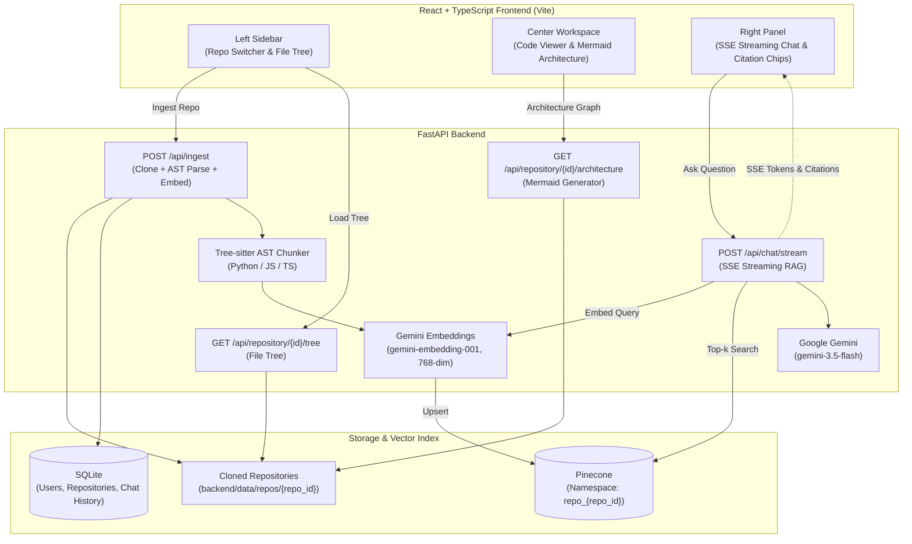

# DevRamp — Codebase Onboarding Assistant

> **DevRamp** turns a GitHub repository into an interactive onboarding workspace: browse the code, see its architecture, and ask questions answered with clickable source citations. Built with **React**, **TypeScript**, **Tailwind CSS**, **FastAPI**, **Pinecone**, **Google Gemini**, and **Tree-sitter**.

---

## 🌟 Core Engineering Highlights

- **Non-blocking RAG Backend (FastAPI + Pinecone + SSE Streaming)**
  - Vector retrieval over isolated Pinecone namespaces, one per repository (`repo_{repo_id}`).
  - Answers stream token-by-token through a FastAPI `StreamingResponse` using Server-Sent Events, so the first words appear while the rest is still being generated.
  - Retrieval boosts chunks from the file currently open in the code viewer while keeping repository-wide context.
- **Semantic Search via Tree-sitter AST Parsing**
  - Instead of fixed-size text chunks, Python, TypeScript, and JavaScript files are parsed with Tree-sitter and indexed as functions, classes, interfaces, and methods, each with its symbol name and line range.
  - Minified bundles are skipped and top-level code is split into smaller chunks.
- **Interactive Workspace (Mermaid.js Graphs & Clickable Citations)**
  - Architecture graphs rendered with Mermaid.js, generated from repository manifests (`package.json`, `requirements.txt`).
  - Chat citations like `[file:src/auth/jwt.py:L42]` open the file in the code viewer and jump to the cited line.
  - Onboarding modules, a setup guide, dependency breakdown, and a checklist generated per repository.

---

## 🏗️ System Architecture



---

## 🔌 API Overview

All routes are served under `/api`.

| Area | Endpoints |
| --- | --- |
| Auth | `POST /auth/signup`, `POST /auth/login`, `POST /auth/github`, `POST /auth/github/connect`, `GET /auth/me` |
| GitHub | `GET /github/repositories`, `POST /github/repositories/access` |
| Ingestion | `POST /ingest`, `POST /repository/{repo_id}/sync`, `GET /repository/{repo_id}/ingestion` |
| Repositories | `GET /repositories`, `GET /repository/{repo_id}`, `GET /repository/{repo_id}/tree`, `GET /repository/{repo_id}/file?path=...` |
| Analysis | `GET /repository/{repo_id}/architecture`, `GET /repository/{repo_id}/dependencies`, `GET /repository/{repo_id}/setup` |
| Onboarding | `GET /repository/{repo_id}/modules`, `GET /repository/{repo_id}/checklist` |
| Chat | `POST /chat/stream` (SSE), `GET /repository/{repo_id}/chat/history` |

The chat stream emits three event types:

```text
event: token
data: {"text": "..."}

event: citation
data: {"file": "src/auth/jwt.py", "line": 42, "label": "..."}

event: done
data: {"messageId": "..."}
```

Interactive API docs are available at `http://localhost:8000/docs` once the backend is running.

---

## 🚀 Quickstart

### Prerequisites

- Python 3.11+ and Node.js 18+
- A [Google Gemini API key](https://aistudio.google.com/apikey) (free tier works)
- A [Pinecone](https://www.pinecone.io/) index with **768** dimensions
- *(Optional)* A GitHub OAuth App for GitHub sign-in and private repositories (callback URL: `http://localhost:5173/auth/github/callback`)

### 1. Backend

```bash
cd backend
python -m venv venv
source venv/bin/activate
pip install -r requirements.txt

# Fill in GEMINI_API_KEY, PINECONE_API_KEY, PINECONE_INDEX_NAME, JWT_SECRET_KEY
# and optionally GITHUB_CLIENT_ID / GITHUB_CLIENT_SECRET
cp .env.example .env

# Start the API at http://localhost:8000
uvicorn app.main:app --host 0.0.0.0 --port 8000 --reload
```

Run the test suite with:

```bash
pytest
```

### 2. Frontend

```bash
cd frontend

# Set VITE_API_URL (defaults to http://localhost:8000) and optionally VITE_GITHUB_CLIENT_ID
cp .env.example .env

# Start the dev server at http://localhost:5173
npm install
npm run dev
```

Set `VITE_USE_MOCK_API=true` in `frontend/.env` to explore the UI with mock data and no backend.

---

## ⚙️ Notes on the Gemini Free Tier

- The free tier embeds roughly 100 chunks per minute, so indexing runs in the background and is capped at 1,500 chunks per repository (`MAX_INDEXED_CHUNKS`). Ingestion progress is available from `GET /api/repository/{repo_id}/ingestion`.
- Repositories larger than 250 MB are rejected (`MAX_REPO_SIZE_MB`).
- If the primary chat model returns a server error, the request is retried with `gemini-3.5-flash-lite`.

---

## 📚 Further Documentation

- [frontend/BACKEND_INTEGRATION.md](frontend/BACKEND_INTEGRATION.md): frontend/backend integration contract.
